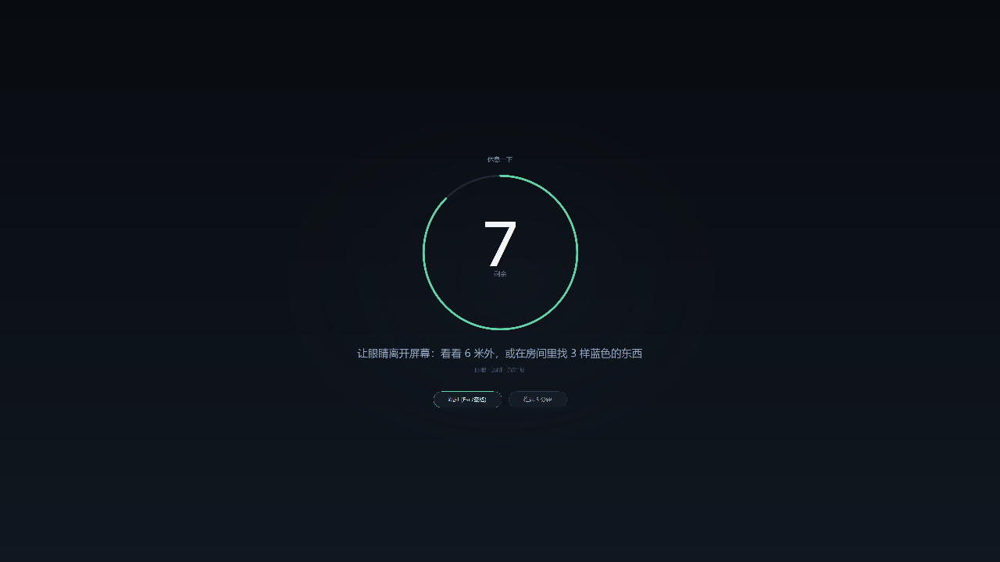
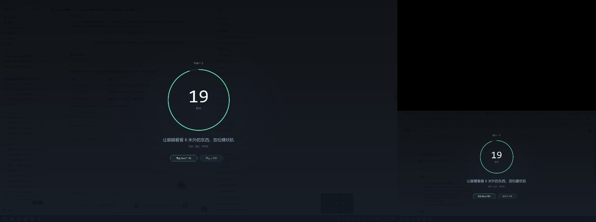
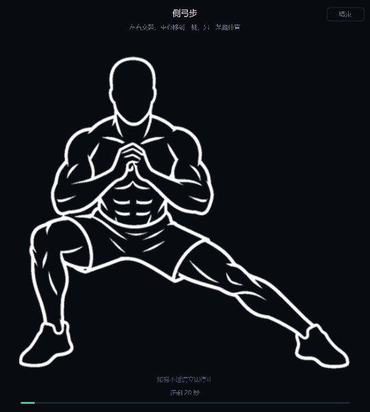
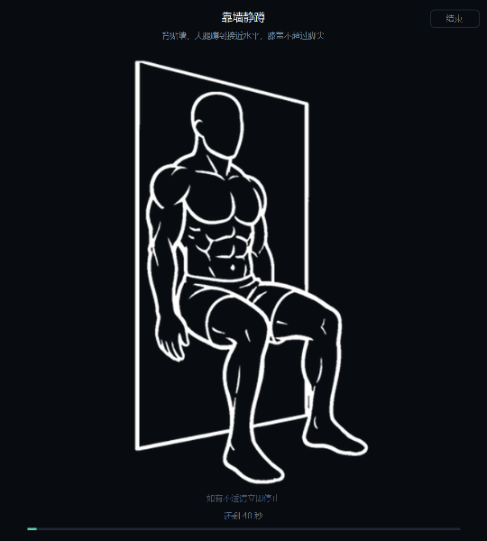
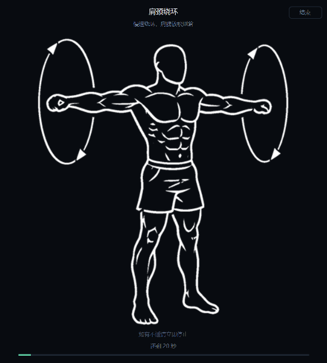
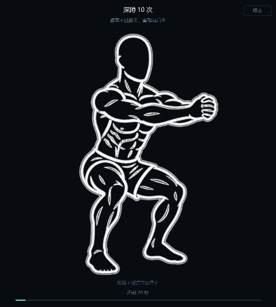
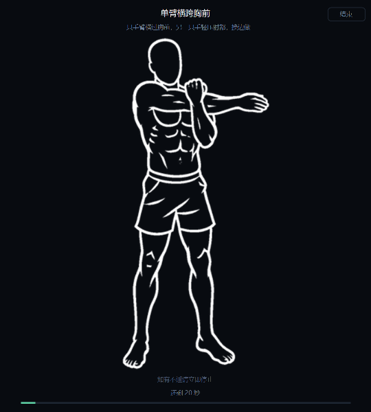
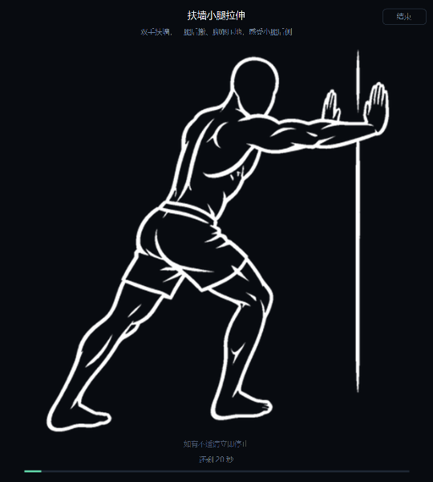
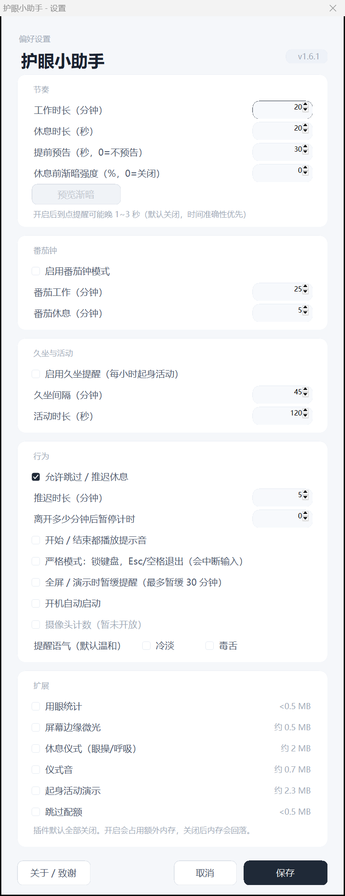

# EyeLite · 轻量护眼提醒

> Windows 托盘护眼提醒小工具：20-20-20 规则 + 番茄钟，常驻托盘。连续运行 10 次休息后私有内存约 **19~21 MB**（承诺上限 45 MB），且基本不增长（原版同场景 209 MB）。

## 这是什么

EyeLite 是一个只做一件事的 Windows 托盘程序：每隔 N 分钟弹出一次全屏休息遮罩，提醒你把视线从屏幕上移开，休息几十秒后再自动消失、继续计时。它不常驻主窗口，不弹通知气泡打扰你，平时只在右下角托盘放一个小图标，鼠标悬停能看到剩余时间。

除了默认的 20-20-20 护眼模式，也可以切换到番茄钟模式（工作 N 分钟、休息 M 分钟）。休息时长、跳过权限、严格程度、离开检测都可以在设置里改，配置写在用户目录下，除开机自启的 Run 项外不碰注册表。

**为什么会有这个项目**：原版 ProjectEye 功能很全，但连续运行几小时后私有内存会涨到 209 MB，对一个「每秒 tick 一次」的托盘工具来说代价太高（增长主要来自用眼统计与 Excel 导出所依赖的 EF6 + NPOI，以及窗体重复创建造成的 GDI 资源累积）。本项目是**完全重写**，目标很明确：保留核心体验，把内存压到 30 MB 量级（约为原版的七分之一）并保持稳定，其余功能一律不做。

## 功能

- 20-20-20 护眼提醒，工作 / 休息时长可自定义
- 番茄钟模式（工作 N 分钟 / 休息 M 分钟）
- **到点前 30 秒预告横幅**：延后 / 跳过 / 立即休息三个出口，预留时间收尾手上的事
- **休息前 60 秒渐进变暗**（**默认关闭**）：整屏缓慢压暗到设定值（0–70%，可现场预览）。
  关掉它是刻意的取舍：每次改透明度都会让系统重合成整屏，实测把「60±3 秒到点」拖成 62~63 秒，
  所以时间准确性优先（细节见[已知限制](#已知限制)）
- **提醒语气三档**：温和 / 冷淡 / 毒舌。只换遮罩上那几句话，不动任何行为与版式；
  毒舌开火的对象只有「椅子 / 屏幕 / 这轮状态」，不碰用户的身体和人格
- **托盘图标即进度环**：剩余时间按比例画成环，宽裕蓝 / 过半黄 / 临近橙，tooltip 给出结构化说明
- **久坐提醒（第二套时钟）**：独立于护眼节奏，到点起身活动一下
- **全屏 / 演示 / 会议时自动暂缓**：全屏与演示读系统通知状态；会议用「进程 + 可见窗口 + 标题关键词」
  三条同时判定（装了客户端不开会不会被抑制）。最多暂缓 30 分钟，超了强制提醒
- 全屏休息遮罩：环形进度 + 倒计时数字画在环心
- 严格模式：休息期间锁住键盘，仅 Esc / 空格可结束（默认关闭，打开会中断输入）
- **锁键盘前 15 秒倒计时**：严格模式下不立刻锁，先给 15 秒收尾，倒计时期间键盘完全自由
- **不该打扰时不打扰**：全屏/演示暂缓、**前台播放器白名单**（看片不糊遮罩）、
  **打字段检测**（正在打字就先等你 5 秒，最多等 60 秒）
- 不抢焦点：遮罩弹出不打断输入法组词与光标位置
- 多显示器：所有屏幕同时遮罩、都有操作按钮、各屏按自身尺寸独立排版（含小屏紧凑模式）
- 高分屏友好：按系统 DPI 自适应缩放
- 离开自动暂停：键鼠无操作超过 N 分钟则暂停计时
- 跳过 / 推迟 N 分钟；**可选「坐一分钟」第三出口**（不想动也不想跳过时）
- **沉浸模式**：照常计时，但一个窗口都不弹（连预告、渐暗、边缘辉光都停）。
  与「暂停」严格区分：**暂停 = 不记账；沉浸 = 记账但不打扰**
- **用眼统计**：完成 / 跳过 / 忽略三态计数，外加「最近 7 天完成」的迷你趋势图
- **插件（默认全部关闭）**：边缘微光、久坐动作演示、眼神操/呼吸圆、仪式音、
  三态统计、跳过配额。**托盘菜单「扩展」和设置页「扩展」卡都能开关**，默认即纯核心
- **久坐动作演示**：9 个动作，**全部使用开源的肌肉线条素材**（3 帧乒乓播放，不再有自绘火柴人）：
  起身伸展 / 深蹲 10 次 / 肩颈绕环 / 原地踏步 / 靠墙静蹲 / 扩胸 / 单臂横跨胸前 / 侧弓步 / 扶墙小腿拉伸。
  支持**禁忌字段**（写「腰」「膝」等词即自动排除相关动作；全部排除时安静休息，不弹窗），
  另有**按痛点组织的三条跟练例程**（肩颈 / 肩 / 腰）
- 开机自启（HKCU Run 项）、单实例
- 配置持久化到 `%APPDATA%\EyeLite\config.ini`

## 界面

程序没有主窗口，日常形态就是托盘里的一个圆形图标：工作时是绿色，休息时变成橙色。

### 休息遮罩

全屏、置顶、深色半透明的一层。屏幕正中是环形进度条，环心用大号数字显示剩余秒数；环上方一行小字标注当前是「休息一下」还是「番茄钟休息」，环下方是主提示与副提示，最底下是「跳过」和「推迟 N 分钟」两个按钮。倒计时期间环形进度随剩余时间收缩。



环下方那句引导语有**三档语气**（设置 →「提醒语气」）。同一件事的三种说法：

| 档位 | 同一句 |
|---|---|
| 温和（默认） | 让眼睛离开屏幕：看看 6 米外，或在房间里找 3 样蓝色的东西 |
| 冷淡 | 看 6 米外，20 秒。或者找 3 样蓝色的东西 |
| 毒舌 | 屏幕不差你这 20 秒。抬头，6 米外，或者找 3 样蓝色的东西 |

毒舌档**只对行为和场景开火**（椅子、屏幕、这轮状态），不碰用户的身体和人格 ——
"你这腰再坐下去就废了"那种写法是医疗暗示，我们没有资格做。

多显示器下每块屏幕各有一层遮罩，各屏按自身尺寸独立排版、都带操作按钮（下图为两块屏同时生效的效果）：



### 预告横幅

到点前会先在右下角弹一张卡片，给三个出口（延后 / 跳过 / 立即休息），避免"到点就被糊一脸"：


右侧的大数字与「秒」按**墨迹底边**对齐（`PreviewForm.AlignUnitToCountBaseline`：先 `DrawToBitmap`，
再在数字与单位的矩形里各自找最下一行亮像素，最后把单位框平移过去）。
不用 `MeasureText` 的行框高，是因为行框底还含 descent 留白，按它对齐会系统性偏低十几像素。

### 动作演示

久坐提醒会弹一个 **720×800** 的演示窗，按顺序播放动作（3 帧乒乓），播完自动收窗；右上角「结束」可随时关掉。
人形占窗高约 **80%** —— 缩小窗口时靠的是重排布局，不是把人缩小。

  

  

9 个动作（全部为开源素材，**没有自绘火柴人**）：

| 动作 | 一句话要领 | 禁忌词 |
|---|---|---|
| 起身伸展 | 双臂向上举过头再缓慢放下，脊柱伸展，别耸肩 | 腰椎、脊柱 |
| 深蹲 10 次 | 膝盖不过脚尖，臀部向后坐 | 膝、腰 |
| 肩颈绕环 | 慢速绕环，肩膀放松别耸 | 颈椎、肩袖、肩 |
| 原地踏步 | 抬到大腿接近水平，落地轻 | 膝、髋 |
| 靠墙静蹲 | 背贴墙，大腿蹲到接近水平，膝盖不超过脚尖 | 膝、腰 |
| 扩胸 | 双臂向后打开，胸口往前送（扶着门框或墙边都行） | 肩、肩袖 |
| 单臂横跨胸前 | 一只手臂横过胸前，另一只手轻压肘部，换边做 | 肩、肩袖 |
| 侧弓步 | 左右交替，重心移到一侧，另一条腿伸直 | 膝、腰 |
| 扶墙小腿拉伸 | 双手扶墙，一腿后撤、脚跟压地，感受小腿后侧 | 跟腱、小腿 |

托盘「缓解一下」里还有三条**按痛点组织的跟练例程**：肩颈 / 肩 / 腰。

素材来自 [`bryllim/workout-guide`](https://github.com/bryllim/workout-guide)（**CC BY-SA 4.0**），
图**原样嵌入未做修改**，署名与许可义务见 [`assets/ATTRIBUTION.md`](assets/ATTRIBUTION.md)；
程序内「设置 → 关于 / 致谢」也能看到（CC BY-SA 要求终端用户可见，放 README 不算）。

> **为什么没有"手腕绕环"和"颈部放松"**：开源世界里没有这两个动作的肌肉线条素材
> （workout-guide 302 条、everkinetic 289 条都没有），用半身图或带器械的图会让人学错动作，
> 因此换成了同样适合工位的「侧弓步」与「扶墙小腿拉伸」。
> 这一步的判断依据记在 [`docs/qa/asset-picking.md`](docs/qa/asset-picking.md)。

### 设置面板



深色遮罩与浅色设置面板是刻意的对比：遮罩要「压住」注意力，设置面板要「好读好改」。

> 本目录的截图由 `tools/shoot.py` 生成（`ctypes` + 标准库 `zlib` 手写 PNG，不依赖 PIL）。
> 它用 `PrintWindow` 让目标窗口自绘，**不会把你桌面上的其它窗口拍进去**。

## 系统要求

- Windows 10 / 11（64 位）
- .NET Framework 4.8（Windows 10 2004 及以后、Windows 11 均系统自带，无需单独安装）
- 无需 .NET SDK、无需 Visual Studio、无需任何第三方包

## 构建

双击 `build.cmd`，产物是同目录下的 `EyeLite.exe`（约 37 KB）。脚本会先检查是否已有实例在运行（会锁住 exe 文件），然后调用 Windows 自带的 C# 编译器：

```
C:\Windows\Microsoft.NET\Framework64\v4.0.30319\csc.exe
```

（64 位系统上找不到时回退到 `Framework` 目录）。编译命令里 **必须带 `/codepage:65001`**——源码是 UTF-8，不指定代码页时 csc 会按系统 ANSI 代码页读取，界面上的中文会全部变成乱码。

构建脚本本身是**纯 ASCII** 编写的，这不是偷懒：`.cmd` 在中文 Windows 下按 GBK 解析，如果脚本里混入 UTF-8 中文注释，多字节字符会吃掉后面的命令，出现「'ist' 不是内部或外部命令」这类莫名其妙的报错。所以脚本界面也是英文的，请不要把它改成中文。

## 使用

- 托盘图标：**双击** = 进入 / 退出番茄钟模式（切完会在右下角弹一张卡，说明新的节奏，点「开始专注」从此刻重新起算）；**右键** = 菜单（暂停计时 / 立即休息 / 番茄钟模式 / 设置… / 开机自动启动 / 退出）
- 「立即休息」在托盘菜单里，是**主动**要一次休息，不受番茄钟影响随时可用
- 鼠标**悬停**托盘图标，提示文字显示当前状态与剩余时间
- 休息时：按 **Esc 或空格** 结束；或点「跳过」直接结束、点「推迟 N 分钟」延后提醒
- 严格模式**默认关闭**（P0-E 起）：休息期间锁住键盘会打断正在输入的内容，卡住的物理键还可能被钩子持续吞掉；默认档下键盘全程可用，只有 Esc / 空格被留作跳过出口。**已实测**（`tools/p0e-input-check.py`，5/5 PASS）：默认档下按键送达、裸 Ctrl `down/up` 成对通过；严格档下全部成对被吞（不会出现"只吞一半"导致 Ctrl 卡死）

## 配置

配置保存在 `%APPDATA%\EyeLite\config.ini`，首次运行自动生成。也可以在托盘菜单「设置…」里改，保存时写回同一文件。

| 字段 | 含义 | 默认值 | 取值范围 |
|---|---|---|---|
| `WorkMinutes` | 工作时长（分钟），到点触发休息 | `20` | 1 ~ 240 |
| `RestSeconds` | 休息时长（秒），仅护眼模式下生效 | `20` | 5 ~ 1800 |
| `PomodoroEnabled` | 是否启用番茄钟模式（`1` 启用 / `0` 关闭）；启用后改用下两项时长 | `0` | `0` / `1` |
| `PomodoroWork` | 番茄钟工作时长（分钟） | `25` | 1 ~ 240 |
| `PomodoroRest` | 番茄钟休息时长（分钟） | `5` | 1 ~ 120 |
| `AllowSkip` | 是否允许跳过 / 推迟休息（`1` 允许）；关闭后遮罩不显示这两个按钮，Esc / 空格也失效 | `1` | `0` / `1` |
| `PostponeMinutes` | 「推迟」按钮延后的分钟数 | `5` | 1 ~ 60 |
| `IdleMinutes` | 键鼠无操作超过该分钟数则暂停计时，`0` 表示不检测 | `3` | 0 ~ 120 |
| `SoundEnabled` | 休息开始 / 结束时是否播放提示音 | `1` | `0` / `1` |
| `StrictMode` | 严格模式，休息期间锁住键盘（会中断输入） | `0` | `0` / `1` |
| `StartWithWindows` | 开机自启（写入 HKCU 的 Run 项） | `0` | `0` / `1` |
| `PreviewSeconds` | 到点前多少秒弹预告横幅，`0` = 不预告直接全屏遮罩 | `30` | 0 ~ 300 |
| `SedentaryEnabled` | 是否启用久坐提醒（第二套时钟，到点起身活动） | `1` | `0` / `1` |
| `SedentaryMinutes` | 久坐间隔（分钟） | `45` | 15 ~ 180 |
| `SedentarySeconds` | 活动时长（秒） | `120` | 30 ~ 300 |
| `SuppressOnFullscreen` | 全屏 / 演示时暂缓提醒（最多暂缓 30 分钟） | `1` | `0` / `1` |
| `DimAlphaMax` | 休息前渐暗的最大强度（%）；`0` = 关闭。**开启会拖慢到点时刻**，见[已知限制](#已知限制) | `0` | 0 ~ 70 |
| `Tone` | 提醒语气：`0` 温和 / `1` 冷淡 / `2` 毒舌（只影响遮罩上的文案） | `0` | 0 ~ 2 |
| `EyeGameEnabled` | 普通护眼休息时把引导语换成「在房间里找东西」 | `1` | `0` / `1` |
| `MovementContraindications` | 动作演示的禁忌关键词，分号分隔（如 `腰;膝`）。命中即静默跳过该动作 | 空 | — |

超出范围的值在读取时会夹回合法区间，不会因为手改配置把程序弄崩。

## 性能

数据来自本机实测（Windows 11 / 双屏 2560×1440 @150%），用仓库里的 `checkmem.ps1` 读取
（`PrivateMemorySize64`，即「私有提交」）。v1.2.0 起把承诺改成**双线**：

| 项 | 上限 | 本机实测 |
|---|---|---|
| **核心裸跑**（不装任何插件） | **≤ 45 MB** | **18.6 MB**（启动 30 s，含会议检测）/ **21.2 MB**（首次休息后，窗体已全部显示）/ 17.7 MB（关掉会议检测） |
| **默认配置**（核心 + 默认插件） | **≤ 55 MB** | 默认不开插件，实测同核心 |
| **动作演示窗开着**（含 3 帧素材缓存） | **≤ 45 MB** | 峰值 **35.2 MB**；切过 3 个动作后 GC 回落到 **24.3 MB** |
| 连续 6 次休息之后 | — | 19.0 MB，之后再跑 240 s 稳定不涨 |

GDI 对象数（`GetGuiResources`）：**启动即 47**（见下），稳态 47 → 47（180 s 零增长）；
再跑 240 s 仍是 47。**动作演示窗开着时升到 52，关窗后回落到 43**，不累积。

> **动作演示的素材缓存有一个硬上限 640×640**（`EnsureAssetFrames` 里的 `MaxCachedSide`）。
> 早先没封顶时按"人形墨迹高度"反算，`side` 会到 ~1100 —— 每帧 4.8MB、三帧 14.5MB，
> 实测进程涨到 **43.9MB**，轮换动作时 **47.6MB 直接越过 45MB 承诺**。
> 源素材本身只有 512×512，放大到 1100 不增加任何细节，只是浪费内存；
> 封顶 640 后峰值 35.2MB，视觉上看不出区别（绘制时由 GDI 放大到目标尺寸）。

> 启动基线从早先的 25 涨到 47，是**故意的**：遮罩窗体的窗口句柄现在在**启动时就创建**，
> 而不是等到「该弹遮罩的那一刻」再建。建句柄（两块全屏 layered 窗口 + 子控件）在冷机状态下要 1~4 秒，
> 正好吃掉提醒的准时性 —— 实测中位从 63.6s 回到 60.5s（详见用例库的调查记录）。
> 换来的是 22 个 GDI 对象与 0.3MB，这笔交易划算。

> **关于旧的 29.2 / 30.2 MB 记录**：那是 v1.1.x 的数字，与本次 17.5 MB 不一致，
> **原因没有查清**（可能是测量时机不同，或旧版本里还有后来被移除的模块）。
> 所以这里不把它写成"优化了 12 MB"——**解释不了的下降不能当成绩**。
> 当前数字以本表为准，`checkmem.ps1` 可以复现。

做到这个量级的原因：

- **窗体只创建一次后复用**：休息遮罩在**第一个 tick 就预热建好**（不是到点才建），
  之后只 `Show()` / `Hide()`；只有显示器增减或分辨率变化时才重建。
  预热还有个副作用是**准时性**：不预热时创建开销正好落在"该弹的那一刻"，
  实测出现过 63.5 s / 64.5 s（期望 60 s）。
- **字体全程序共享**：所有 `Font` 提为静态只读字段，全进程一份，不随窗体创建销毁
- **每秒计时路径不新建任何 GDI 对象**：计时器回调只更新文本与一个进度宽度，
  重绘用的渐变画刷在窗体构造时建好并复用
- **载体按最小必要频率重绘**：托盘进度环只在"剩余跨整分钟"时重画；
  渐暗层用整窗 alpha（每秒最多一档），不做像素级重采样
- **图标句柄自己拥有**：进度环用 `Icon.FromHandle(...).Clone()` 拿到自有句柄，
  换帧时 `Dispose` 旧 Icon（`Icon.FromHandle` 返回的对象**不拥有** HICON，
  这是 .NET 里最容易漏的一条所有权规则，且托盘图标泄漏是永久的）
- **没有事件订阅泄漏**：原版的内存增长主要来自窗体关闭后事件订阅未解除
  （21 处 `+=` 无对应 `-=`），本项目不给任何长生命周期对象订阅事件

## 插件（默认全部关闭）

插件是**进程内**的：接口 + 静态注册 + `config.ini` 开关 + 延迟初始化 + 显式释放，
**不加载外部 DLL**。

> 为什么不用 `Assembly.LoadFrom`：**.NET Framework 下程序集无法卸载**。
> 用 DLL 方案，"关掉插件内存就降回去"恰恰做不到；而"开启才占内存"用延迟初始化就能满足。
> 硬盘占用无所谓，所以"多文件分发"不构成理由。

**默认即纯核心**：6 个插件出厂全关，不启用时连对象都不创建（不是"创建了但不用"）。
设置页「扩展」卡是唯一开关入口，占用标注**只写实测值，没测过的写「待测」**——不写估算。

## 设计取舍

相对原版 ProjectEye，主动去掉的东西和理由：

| 去掉的功能 | 原因 |
|---|---|
| 用眼统计图表 / 导出 Excel | 这是原版内存的主要来源（EF6 + NPOI），与「轻量」目标直接冲突 |
| 自定义提示界面（换图、调布局） | 只保留一套固定版式，省掉图片资源加载与布局配置 |
| 多主题 | 只保留深色遮罩，浅色主题在全屏遮罩场景没有实际价值 |
| EyesTest 视力测试 | 使用频率低，且需要额外的图形与素材 |
| 音乐提醒 | 改为代码实时合成的系统音效，不依赖音频文件 |

## 已知限制

- 严格模式依赖全局低级键盘钩子（`WH_KEYBOARD_LL`），个别杀毒软件可能把它当成键盘记录器并给出提示；可以在设置里关闭，关闭后其余功能不受影响
- 严格模式挡的是「手滑式跳过」，不是对抗——任务管理器结束进程、提权程序、Win+G 游戏栏都能绕过它。它的目标是让休息有一点点摩擦力，不是当家长
- 严格模式对**以管理员身份运行**的程序无效。Windows 的 UIPI 机制下，普通权限进程安装的键盘钩子收不到发往高完整性级别窗口的输入，所以当你在提权的终端、IDE 里休息时，按键仍会送达到那个程序。程序本身以普通权限运行——这是刻意的，加管理员清单会让每次开机都弹 UAC
- 「不抢焦点」是刻意设计：休息期间遮罩不会获得键盘焦点，因此 Esc / 空格是通过键盘钩子而非窗体焦点处理的
- **「休息前渐暗」默认关闭，且建议保持关闭**。每次给整屏分层窗写 `Opacity`，DWM 就会重合成整块屏幕；
  60 秒窗口里累计几十次，正好压在"该弹遮罩"那几秒上。同一台机器、同一判据、只改这一个变量的实测：

  | 配置 | 五轮到点时刻（秒） | 中位 | 超 ±3s |
  |---|---|---|---|
  | 渐暗 45%（旧默认） | 60.53 / 62.38 / 63.50 / 60.43 / 62.41 | 62.38 | 1/5 |
  | 渐暗关闭 | 60.52 / 60.54 / 61.38 / 60.55 / 60.51 | 60.54 | 0/5 |

  方差从 3.97s 的跨度塌到 0.86s。「60±3 秒」是这个产品对用户的核心承诺，渐暗只是美化层，
  所以把默认值改成 `0`，并在代码里做了两件事减少它的代价（最后 5 秒完全静默、步进从 1s 放宽到 2s）。
  老配置里显式写着 `DimAlphaMax=45` 的依然生效 —— 不替用户推翻他自己的选择
- 仅支持 Windows，且依赖 .NET Framework 4.8；没有跨平台计划

## 目录结构

```
EyeLite/
├─ src/Program.cs          # 全部源码（单文件，约 9300 行；无第三方依赖）
├─ build.cmd               # 双击编译（用系统自带 csc.exe）；/check = 只做语法门
├─ build-check.cmd         # 语法门入口（不覆盖正在运行的 EyeLite.exe）
├─ release.cmd             # 编译 + 打包 dist/EyeLite-<版本>.zip
├─ checkmem.cmd/.ps1       # 查看内存占用与 GDI 对象数
├─ assets/
│  ├─ ATTRIBUTION.md       # 素材署名与许可（CC BY-SA 4.0）
│  └─ moves/               # 9 个动作 × 3 帧 + manifest.json（约 1.1 MB）
├─ docs/
│  ├─ README.md            # 文档索引：先看这一页
│  ├─ RestGate-契约.md      # 行为契约（改行为前必读）
│  ├─ P2-计划.md           # 计划与拍板记录（含"为什么当初这么决定"）
│  ├─ qa/                  # 用例定义、验收记录、选型与调查
│  └─ screenshots/         # README 用图，全部由 tools/shoot.py 生成
├─ tools/                  # 验收脚本（27 个 Python，零第三方依赖）
│  ├─ p0-regression.py     # P0 总回归：fast ≈ 4 分钟 / all ≈ 20~35 分钟
│  ├─ p1-batch*.py         # 插件与反作弊
│  ├─ p2-*.py / p3-*.py    # 功能专项
│  └─ shoot.py             # 截图（PrintWindow，绝不截屏）
├─ LICENSE                 # MIT
└─ README.md
```

## 来源与致谢

- 需求与灵感来源：**ProjectEye**（https://github.com/Planshit/ProjectEye，MIT License，作者 Planshit）
- 本项目为**从零重写**，未复用原项目代码；只参考了它的功能定位与 20-20-20 规则
- 界面与音效实现：.NET Framework WinForms；提示音由代码实时合成 WAV，不依赖音频文件

## 许可证

MIT，见 [LICENSE](LICENSE)。
