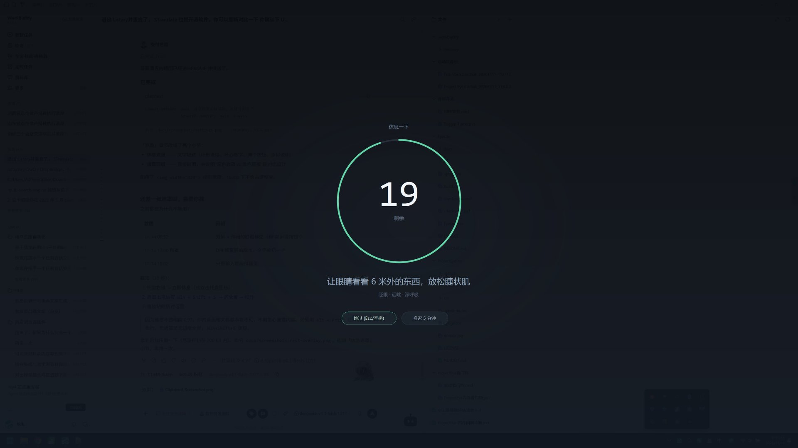

# EyeLite · 轻量护眼提醒

> Windows 托盘护眼提醒小工具：20-20-20 规则 + 番茄钟，常驻托盘。连续运行 10 次休息后私有内存约 30 MB，且基本不增长（原版同场景 209 MB）。

## 这是什么

EyeLite 是一个只做一件事的 Windows 托盘程序：每隔 N 分钟弹出一次全屏休息遮罩，提醒你把视线从屏幕上移开，休息几十秒后再自动消失、继续计时。它不常驻主窗口，不弹通知气泡打扰你，平时只在右下角托盘放一个小图标，鼠标悬停能看到剩余时间。

除了默认的 20-20-20 护眼模式，也可以切换到番茄钟模式（工作 N 分钟、休息 M 分钟）。休息时长、跳过权限、严格程度、离开检测都可以在设置里改，配置写在用户目录下，除开机自启的 Run 项外不碰注册表。

**为什么会有这个项目**：原版 ProjectEye 功能很全，但连续运行几小时后私有内存会涨到 209 MB，对一个「每秒 tick 一次」的托盘工具来说代价太高（增长主要来自用眼统计与 Excel 导出所依赖的 EF6 + NPOI，以及窗体重复创建造成的 GDI 资源累积）。本项目是**完全重写**，目标很明确：保留核心体验，把内存压到 30 MB 量级（约为原版的七分之一）并保持稳定，其余功能一律不做。

## 功能

- 20-20-20 护眼提醒，工作 / 休息时长可自定义
- 番茄钟模式（工作 N 分钟 / 休息 M 分钟）
- **到点前 30 秒预告横幅**：延后 / 跳过 / 立即休息三个出口，预留时间收尾手上的事
- **休息前 60 秒渐进变暗**：整屏缓慢压暗到 45%（可在设置里调 0–70% 并现场预览），
  任何键鼠输入立即撤销且本轮不再打扰
- **托盘图标即进度环**：剩余时间按比例画成环，宽裕蓝 / 过半黄 / 临近橙，tooltip 给出结构化说明
- **久坐提醒（第二套时钟）**：独立于护眼节奏，到点起身活动一下
- **全屏 / 演示时自动暂缓**：读系统通知状态，不在演示中途糊遮罩（最多暂缓 30 分钟）
- 全屏休息遮罩：环形进度 + 倒计时数字画在环心
- 严格模式：休息期间锁住键盘，仅 Esc / 空格可结束（默认关闭，打开会中断输入）
- 不抢焦点：遮罩弹出不打断输入法组词与光标位置
- 多显示器：所有屏幕同时遮罩、都有操作按钮、各屏按自身尺寸独立排版（含小屏紧凑模式）
- 高分屏友好：按系统 DPI 自适应缩放
- 离开自动暂停：键鼠无操作超过 N 分钟则暂停计时
- 跳过 / 推迟 N 分钟
- 开机自启（HKCU Run 项）、单实例
- 配置持久化到 `%APPDATA%\EyeLite\config.ini`

## 界面

程序没有主窗口，日常形态就是托盘里的一个圆形图标：工作时是绿色，休息时变成橙色。

### 休息遮罩

全屏、置顶、深色半透明的一层。屏幕正中是环形进度条，环心用大号数字显示剩余秒数；环上方一行小字标注当前是「休息一下」还是「番茄钟休息」，环下方是主提示与副提示，最底下是「跳过」和「推迟 N 分钟」两个按钮。倒计时期间环形进度随剩余时间收缩。



多显示器下每块屏幕各有一层遮罩，各屏按自身尺寸独立排版、都带操作按钮（下图为两块屏同时生效的效果）：


### 设置面板


深色遮罩与浅色设置面板是刻意的对比：遮罩要「压住」注意力，设置面板要「好读好改」。

## 系统要求

- Windows 10 / 11（64 位）
- .NET Framework 4.8（Windows 10 2004 及以后、Windows 11 均系统自带，无需单独安装）
- 无需 .NET SDK、无需 Visual Studio、无需任何第三方包

## 构建

双击 `build.cmd`，产物是同目录下的 `EyeLite.exe`（约 37 KB）。脚本会先检查是否已有实例在运行（会锁住 exe 文件），然后调用 Windows 自带的 C# 编译器：

```
C:\Windows\Microsoft.NET\Framework64\v4.0.30319\csc.exe
```

（64 位系统上找不到时回退到 `Framework` 目录）。编译命令里 **必须带 `/codepage:65001`**——源码是 UTF-8，不指定代码页时 csc 会按系统 ANSI 代码页读取，界面上的中文会全部变成乱码。

构建脚本本身是**纯 ASCII** 编写的，这不是偷懒：`.cmd` 在中文 Windows 下按 GBK 解析，如果脚本里混入 UTF-8 中文注释，多字节字符会吃掉后面的命令，出现「'ist' 不是内部或外部命令」这类莫名其妙的报错。所以脚本界面也是英文的，请不要把它改成中文。

## 使用

- 托盘图标：**双击** = 立即休息；**右键** = 菜单（暂停计时 / 立即休息 / 设置… / 开机自动启动 / 退出）
- 鼠标**悬停**托盘图标，提示文字显示当前状态与剩余时间
- 休息时：按 **Esc 或空格** 结束；或点「跳过」直接结束、点「推迟 N 分钟」延后提醒
- 严格模式**默认关闭**（P0-E 起）：休息期间锁住键盘会打断正在输入的内容，卡住的物理键还可能被钩子持续吞掉；默认档下键盘全程可用，只有 Esc / 空格被留作跳过出口。**已实测**（`tools/p0e-input-check.py`，5/5 PASS）：默认档下按键送达、裸 Ctrl `down/up` 成对通过；严格档下全部成对被吞（不会出现"只吞一半"导致 Ctrl 卡死）

## 配置

配置保存在 `%APPDATA%\EyeLite\config.ini`，首次运行自动生成。也可以在托盘菜单「设置…」里改，保存时写回同一文件。

| 字段 | 含义 | 默认值 | 取值范围 |
|---|---|---|---|
| `WorkMinutes` | 工作时长（分钟），到点触发休息 | `20` | 1 ~ 240 |
| `RestSeconds` | 休息时长（秒），仅护眼模式下生效 | `20` | 5 ~ 1800 |
| `PomodoroEnabled` | 是否启用番茄钟模式（`1` 启用 / `0` 关闭）；启用后改用下两项时长 | `0` | `0` / `1` |
| `PomodoroWork` | 番茄钟工作时长（分钟） | `25` | 1 ~ 240 |
| `PomodoroRest` | 番茄钟休息时长（分钟） | `5` | 1 ~ 120 |
| `AllowSkip` | 是否允许跳过 / 推迟休息（`1` 允许）；关闭后遮罩不显示这两个按钮，Esc / 空格也失效 | `1` | `0` / `1` |
| `PostponeMinutes` | 「推迟」按钮延后的分钟数 | `5` | 1 ~ 60 |
| `IdleMinutes` | 键鼠无操作超过该分钟数则暂停计时，`0` 表示不检测 | `3` | 0 ~ 120 |
| `SoundEnabled` | 休息开始 / 结束时是否播放提示音 | `1` | `0` / `1` |
| `StrictMode` | 严格模式，休息期间锁住键盘（会中断输入） | `0` | `0` / `1` |
| `StartWithWindows` | 开机自启（写入 HKCU 的 Run 项） | `0` | `0` / `1` |
| `PreviewSeconds` | 到点前多少秒弹预告横幅，`0` = 不预告直接全屏遮罩 | `30` | 0 ~ 300 |
| `SedentaryEnabled` | 是否启用久坐提醒（第二套时钟，到点起身活动） | `1` | `0` / `1` |
| `SedentaryMinutes` | 久坐间隔（分钟） | `45` | 15 ~ 180 |
| `SedentarySeconds` | 活动时长（秒） | `120` | 30 ~ 300 |
| `SuppressOnFullscreen` | 全屏 / 演示时暂缓提醒（最多暂缓 30 分钟） | `1` | `0` / `1` |

超出范围的值在读取时会夹回合法区间，不会因为手改配置把程序弄崩。

## 性能

数据来自本机实测（Windows 11 / 双屏 2560×1440 @150%），用仓库里的 `checkmem.ps1` 读取
（`PrivateMemorySize64`，即「私有提交」）。v1.2.0 起把承诺改成**双线**：

| 项 | 上限 | 本机实测 |
|---|---|---|
| **核心裸跑**（不装任何插件） | **≤ 45 MB** | **17.5 MB**（启动 30 s）/ 17.4 MB（180 s） |
| **默认配置**（核心 + 默认插件） | **≤ 55 MB** | 默认不开插件，实测同核心 |
| 连续 6 次休息之后 | — | 19.0 MB，之后再跑 240 s 稳定不涨 |

GDI 对象数（`GetGuiResources`）：空闲稳态 24 → 24（180 s 零增长）；
首次显示过全部界面后 53 → 53（再跑 240 s 零增长）。

> **关于旧的 29.2 / 30.2 MB 记录**：那是 v1.1.x 的数字，与本次 17.5 MB 不一致，
> **原因没有查清**（可能是测量时机不同，或旧版本里还有后来被移除的模块）。
> 所以这里不把它写成"优化了 12 MB"——**解释不了的下降不能当成绩**。
> 当前数字以本表为准，`checkmem.ps1` 可以复现。

做到这个量级的原因：

- **窗体只创建一次后复用**：休息遮罩在**第一个 tick 就预热建好**（不是到点才建），
  之后只 `Show()` / `Hide()`；只有显示器增减或分辨率变化时才重建。
  预热还有个副作用是**准时性**：不预热时创建开销正好落在"该弹的那一刻"，
  实测出现过 63.5 s / 64.5 s（期望 60 s）。
- **字体全程序共享**：所有 `Font` 提为静态只读字段，全进程一份，不随窗体创建销毁
- **每秒计时路径不新建任何 GDI 对象**：计时器回调只更新文本与一个进度宽度，
  重绘用的渐变画刷在窗体构造时建好并复用
- **载体按最小必要频率重绘**：托盘进度环只在"剩余跨整分钟"时重画；
  渐暗层用整窗 alpha（每秒最多一档），不做像素级重采样
- **图标句柄自己拥有**：进度环用 `Icon.FromHandle(...).Clone()` 拿到自有句柄，
  换帧时 `Dispose` 旧 Icon（`Icon.FromHandle` 返回的对象**不拥有** HICON，
  这是 .NET 里最容易漏的一条所有权规则，且托盘图标泄漏是永久的）
- **没有事件订阅泄漏**：原版的内存增长主要来自窗体关闭后事件订阅未解除
  （21 处 `+=` 无对应 `-=`），本项目不给任何长生命周期对象订阅事件

## 设计取舍

相对原版 ProjectEye，主动去掉的东西和理由：

| 去掉的功能 | 原因 |
|---|---|
| 用眼统计图表 / 导出 Excel | 这是原版内存的主要来源（EF6 + NPOI），与「轻量」目标直接冲突 |
| 自定义提示界面（换图、调布局） | 只保留一套固定版式，省掉图片资源加载与布局配置 |
| 多主题 | 只保留深色遮罩，浅色主题在全屏遮罩场景没有实际价值 |
| EyesTest 视力测试 | 使用频率低，且需要额外的图形与素材 |
| 音乐提醒 | 改为代码实时合成的系统音效，不依赖音频文件 |

## 已知限制

- 严格模式依赖全局低级键盘钩子（`WH_KEYBOARD_LL`），个别杀毒软件可能把它当成键盘记录器并给出提示；可以在设置里关闭，关闭后其余功能不受影响
- 严格模式挡的是「手滑式跳过」，不是对抗——任务管理器结束进程、提权程序、Win+G 游戏栏都能绕过它。它的目标是让休息有一点点摩擦力，不是当家长
- 严格模式对**以管理员身份运行**的程序无效。Windows 的 UIPI 机制下，普通权限进程安装的键盘钩子收不到发往高完整性级别窗口的输入，所以当你在提权的终端、IDE 里休息时，按键仍会送达到那个程序。程序本身以普通权限运行——这是刻意的，加管理员清单会让每次开机都弹 UAC
- 「不抢焦点」是刻意设计：休息期间遮罩不会获得键盘焦点，因此 Esc / 空格是通过键盘钩子而非窗体焦点处理的
- 仅支持 Windows，且依赖 .NET Framework 4.8；没有跨平台计划

## 目录结构

```
EyeLite/
├─ src/Program.cs      # 全部源码（单文件，约 2000 行）
├─ build.cmd           # 双击编译（用系统自带 csc.exe）
├─ checkmem.cmd/.ps1   # 查看内存占用
├─ LICENSE             # MIT
├─ .gitignore
└─ README.md
```

## 来源与致谢

- 需求与灵感来源：**ProjectEye**（https://github.com/Planshit/ProjectEye，MIT License，作者 Planshit）
- 本项目为**从零重写**，未复用原项目代码；只参考了它的功能定位与 20-20-20 规则
- 界面与音效实现：.NET Framework WinForms；提示音由代码实时合成 WAV，不依赖音频文件

## 许可证

MIT，见 [LICENSE](LICENSE)。
